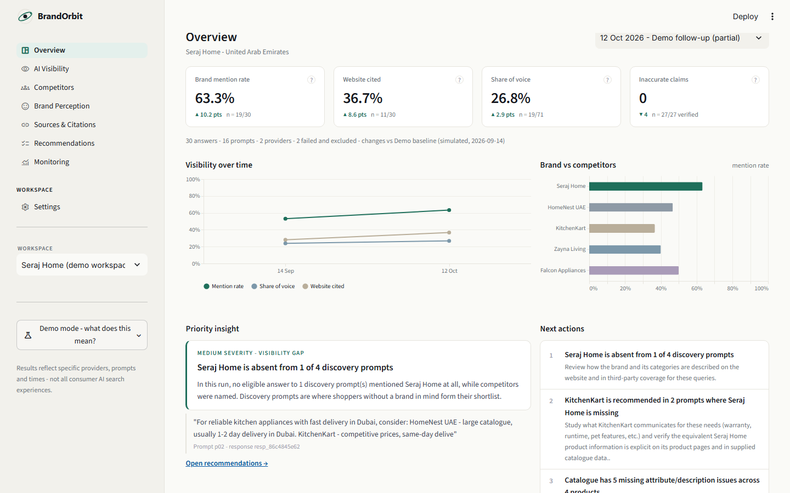
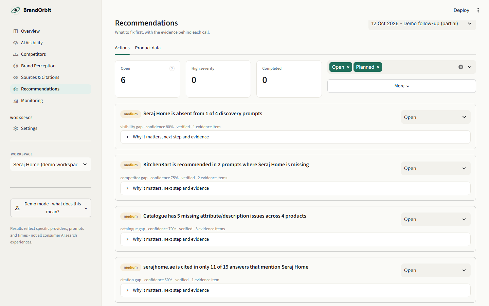
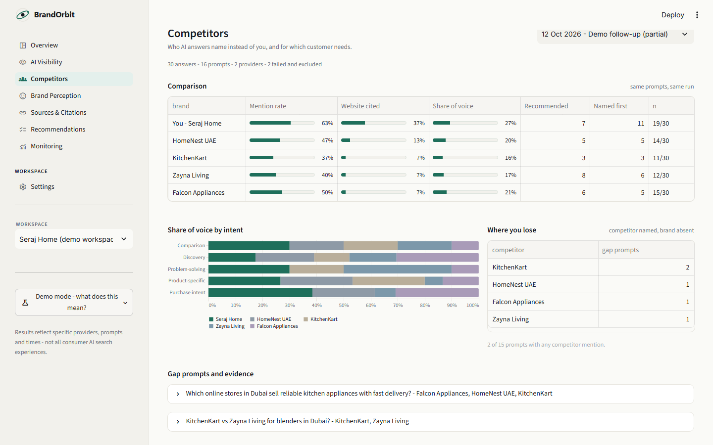
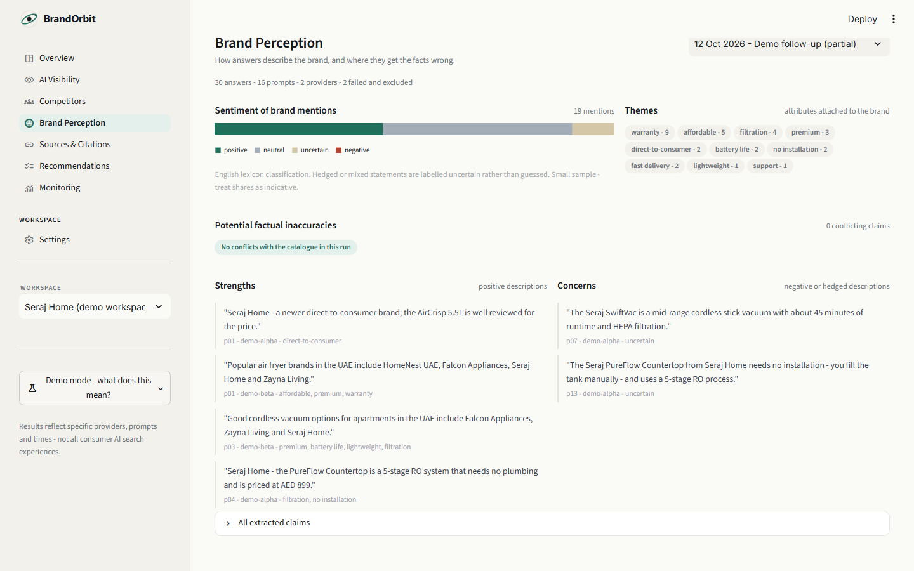

# BrandOrbit

**See how AI sees your brand.**

BrandOrbit is a working prototype of an AI search visibility and brand intelligence platform
for e-commerce brands. Traditional SEO asks whether your website ranks. BrandOrbit asks:

* Does an AI assistant mention my brand when shoppers ask relevant questions?
* Which competitors appear instead of me, and for which customer needs?
* Which sources do AI answers cite when they recommend products?
* How accurately do AI answers describe my products, prices and policies?
* Which product-data or content gaps might explain poor visibility?
* What should my team change, and how do we measure the result?

It connects monitoring, evidence, competitor intelligence, diagnosis and recommendations into
one workflow, and it runs fully in **Demo Mode** without any API key.

> Independent portfolio project. Not affiliated with any company. The demo brand, its
> competitors, reviewer sites, URLs and every "AI answer" in the demo are fictional and
> hand-written; they are labelled as such throughout the app. Results in live mode reflect the
> specific provider, model, prompt and time of each run - not all consumer AI search experiences.

---

## Contents

1. [Who it is for](#who-it-is-for)
2. [Features](#features)
3. [Quick start](#quick-start)
4. [Demo Mode vs live providers](#demo-mode-vs-live-providers)
5. [Architecture](#architecture)
6. [Metric definitions](#metric-definitions)
7. [Evaluation results](#evaluation-results)
8. [Example findings with evidence](#example-findings-with-evidence)
9. [Security, privacy and data retention](#security-privacy-and-data-retention)
10. [Limitations and future work](#limitations-and-future-work)
11. [Case study: design choices](#case-study-design-choices)

---

## Who it is for

An e-commerce founder, growth marketer or brand operator who wants to understand their brand's
presence in AI-generated shopping answers. One brand and several competitors per workspace. The
default demo is a fictional UAE appliance brand ("Seraj Home") with AED prices; country,
currency, language, brand details and competitors are configurable.

## Features

| Area | What you get |
|---|---|
| **Onboarding** | Brand name/website, industry, categories, country & currency, competitors, CSV product catalogue (validated: columns, size, duplicates), prompt set. Default demo workspace needs no configuration. |
| **Prompt set** | Manual prompts; template or LLM-generated suggestions in five categories (discovery, comparison, product-specific, problem-solving, purchase intent); suggestions must be reviewed and approved before monitoring; prompts persist across runs. |
| **Monitoring** | Provider abstraction with a fixture provider (demo), OpenAI Responses API + web search, and Anthropic Messages API + web search. Per response: prompt, category, provider, model, immutable raw text, citations, status, latency, tokens, `source_kind`. Timeouts, bounded retries, per-run limits, partial-run handling. |
| **Overview** | Four KPIs (mention rate, website cited, share of voice, inaccurate claims) with change vs the previous run and sample sizes, visibility trend, brand-vs-competitor bar, one evidence-backed priority insight, top three actions. |
| **AI Visibility** | Trend by provider, breakdown by provider (brand vs competitors) and by prompt intent, prompts where the brand is missing, methodology in an expander. |
| **Competitors** | Comparison table (mention rate, website cited, share of voice, recommended, named first), share of voice by intent, where you lose (gap prompts per competitor) with prompt-level evidence quotes. |
| **Brand Perception** | Sentiment distribution, themes, potential factual inaccuracies each linked to the exact stored answer, strengths and concerns quotes, all claims in an expander. |
| **Sources & Citations** | Cited domains by owner type (yours / competitor / third party), sources supporting competitors, prompts where the brand is mentioned without your site being cited, all URLs. |
| **Recommendations** | *Actions*: findings with severity, confidence, verification status, status control (open/planned/completed/dismissed), progressive-disclosure details with verbatim evidence, re-run related prompts, optional schema-validated LLM narration. *Product data*: catalogue and website audit grouped by severity and type, Markdown report and JSON export. |
| **Monitoring** | *Runs*: history table, failed-call details, new-run dialog, baseline selection. *Before & after*: metric deltas on common prompts, gained/lost mentions, competitor presence, cited sources, wording diffs, completed recommendations, causation disclaimer. *Prompt explorer*: raw immutable answers side by side per provider with extracted analysis visually separated. |
| **Settings** | Brand & competitors, product catalogue, prompt management and approval, providers & mode (demo/live explanation, limits, call log), data retention and export. |

### Screenshots

| Overview | Recommendations |
|---|---|
|  |  |

| Competitors | Brand Perception |
|---|---|
|  |  |

More in `docs/screenshots/` (AI Visibility, Sources & Citations, Monitoring, Settings). Captured from the demo workspace with `python -m evaluation.screenshots`.

## Quick start

Requires Python 3.11+.

```bash
git clone https://github.com/pasta55999/brandorbit.git
cd brandorbit
python -m venv .venv
# Windows: .venv\Scripts\activate      macOS/Linux: source .venv/bin/activate
pip install -r requirements.txt
streamlit run streamlit_app.py
```

Open http://localhost:8501. The demo workspace (two simulated monitoring runs, findings,
baseline) is created automatically on first start.

Run the tests and the evaluation harness:

```bash
pytest                          # 51 tests incl. headless rendering of every page
python -m evaluation.run_eval   # extraction evaluation on the labelled set (add --llm with a key)
```

## Demo Mode vs live providers

| | Demo Mode (default) | Live |
|---|---|---|
| Requirement | none | `OPENAI_API_KEY` and/or `ANTHROPIC_API_KEY` in `.env` |
| Answers | hand-written fixtures for the 16 demo prompts, `source_kind=demo_fixture`, `demo-alpha` / `demo-beta` providers | real API responses with citations where the provider returns them |
| Labelling | sidebar "Demo mode" control with an explanation, "Demo fixture" tag on each answer, demo column in run history | "Live" chip |
| New prompts | demo providers return a labelled **error** (they never invent answers) | monitored normally |
| LLM features | prompt suggestions fall back to templates; LLM extraction/narration disabled | enabled |

To enable live monitoring:

```bash
cp .env.example .env
# edit .env and set OPENAI_API_KEY (Responses API with web_search) and/or ANTHROPIC_API_KEY (Messages API with web_search tool)
streamlit run streamlit_app.py
```

Other settings in `.env.example`: timeouts, retry count, per-run prompt/call limits, opt-in
website fetching (`BRANDORBIT_ALLOW_WEBSITE_FETCH=true`), database path.

**Note on live providers.** The OpenAI and Anthropic adapters were written against the current
SDKs (`openai` 1.x Responses API, `anthropic` 0.x Messages API with `web_search_20250305`) but
were **not exercised against the real APIs** during this build because no key was available.
Treat the first live run as a smoke test; errors are captured per call and shown in
Settings -> Providers & data.

## Architecture

```
Streamlit UI (brandorbit/ui)  ->  core/metrics, analysis/*, audits/*  ->  storage/Repository (SQLite)
                                           ^
                     monitoring/runner  ---+---  providers/ (Demo | OpenAI | Anthropic)
```

* `brandorbit/core` - Pydantic schemas, config from env, catalogue parsing, metrics.
* `brandorbit/providers` - `Provider` interface, demo fixture provider, OpenAI and Anthropic adapters with retries/timeouts.
* `brandorbit/monitoring` - run execution with append-only raw responses and call logs; demo workspace loader.
* `brandorbit/analysis` - deterministic extraction, optional LLM extraction/suggestions, rule-based findings with optional LLM narration, before/after comparison.
* `brandorbit/audits` - catalogue audit, website snapshot/live inspection, Markdown report.
* `brandorbit/storage` - SQLite repository (JSON documents + indexed columns).
* `brandorbit/ui` - `theme.py` (palette, CSS, Altair theme), `common.py` (reusable components: KPI cards, sections, charts, evidence quotes), one module per page; `streamlit_app.py` wires navigation.
* `data/demo` - fictional workspace, catalogue, website snapshot, prompts, two fixture runs. `data/eval` - labelled evaluation set.
* `tests`, `evaluation`, `docs` (ARCHITECTURE, METRICS, DECISIONS), `EVALUATION.md`.

Full diagram and data flow: [docs/ARCHITECTURE.md](docs/ARCHITECTURE.md).

## Metric definitions

Short version (full definitions, denominators and handling of failed calls in
[docs/METRICS.md](docs/METRICS.md)):

* **Eligible answer** - response with status `ok` and non-empty text. Failed/timed-out/malformed answers are excluded from denominators and shown as coverage gaps.
* **Mention rate** - % of eligible answers mentioning the brand (alias/domain, word-boundary).
* **Citation rate** - % of eligible answers citing the brand's website domain.
* **Share of voice** - brand mentions / all detected brand mentions (target + competitors), max one per brand per answer.
* **Competitor gap** - prompts where a competitor appears in some eligible answer and the target in none.
* **Brand accuracy rate** - verified claims / (verified + conflicting) claims against the catalogue; unverifiable claims excluded and reported.

Every number in the UI is shown with its `numerator/denominator`.

## Evaluation results

From `python -m evaluation.run_eval` on the 24-case labelled set (details, confusion matrix and
failure analysis in [EVALUATION.md](EVALUATION.md)):

| Metric | naive substring | rule-based (used in app) | LLM-assisted |
|---|---|---|---|
| Brand-mention precision / recall / F1 | 1.000 / 0.844 / 0.915 | 0.970 / 1.000 / 0.985 | not run (no API key) |
| Target sentiment accuracy | n/a (no sentiment) | 16/19 = 0.842 | not run |
| Website-citation detection | 21/22 | 22/22 | not run |
| Claim (attribute, status) recall | 0/14 | 14/14 | not run |
| Ineligible responses excluded | 0/2 | 2/2 | not run |

Remaining deterministic failures: one false positive where the competitor alias "Zayna" matches
a person's first name (kept deliberately), and three conservative sentiment calls (neutral or
uncertain instead of positive). The set is small and synthetic; it demonstrates behaviour on
designed scenarios, not real-world accuracy.

## Example findings with evidence

Generated by the rules engine on the demo baseline run (fictional data):

**F-ACC-001 - high - Answers state a price for Seraj AirCrisp 5.5L Air Fryer that conflicts with catalogue data**
Evidence: prompt `p05`, response from `demo-alpha`:
> "Seraj Home's flagship AirCrisp 5.5L costs AED 349 and comes with a 1-year warranty."

Catalogue value: AED 299. Source cited by the answer: `dealsdubai.net/seraj-aircrisp-review`.
Proposed action: confirm the catalogue value, then check the cited source and the product page's
structured data. Expected outcome (hypothesis): once public sources agree, later answers are more
likely to repeat the correct figure.

**F-GAP-002 - medium - Zayna Living is recommended in 2 prompts where Seraj Home is missing**
Evidence: `p06` ("For daily use, Zayna Living is likely to last longer") and `p11` ("Zayna Living is
the usual recommendation ... sound-dampening enclosure"). The catalogue shows the VitaBlend Pro
ships with a quiet shield, but no monitored answer surfaced it - a content-gap hypothesis.

**F-SRC-002 - medium, unverifiable - Answers citing uaehomeguide.com contain statements that look outdated**
Evidence: `p13`: "Note that Seraj Home only ships within Dubai". Marked *unverifiable* because the
cited page was not fetched in demo mode.

In the follow-up fixture run, after simulated fixes marked *completed*, the comparison view shows
mention rate 53.1% -> 63.3% (17/32 -> 19/30), four gained and one lost mention, conflicting claims
4 -> 0, and two coverage mismatches (one timeout, one malformed answer) - with the standing
reminder that run-to-run differences do not establish causation.

## Security, privacy and data retention

* API keys are read from environment variables / `.env` only. `.env`, databases and caches are git-ignored; `.env.example` contains placeholders.
* Uploaded CSVs are type- and size-checked (2 MB, 2000 rows) and parsed with pandas; nothing uploaded is executed.
* Prompts, answers, catalogue rows and fetched HTML are treated as untrusted data: LLM calls wrap them in delimited blocks with instructions to ignore embedded instructions, model output is schema-validated, and model-supplied quotes must exist verbatim in the source or are discarded. No model output is executed.
* BrandOrbit never changes websites, sends messages or calls third-party systems on your behalf. Recommendations are advisory.
* Website inspection is off by default; when enabled it fetches at most five product pages, honours `robots.txt`, and parses only JSON-LD, title, meta description and price. No AI platforms are scraped; provider access uses documented APIs.
* Data retained locally in SQLite: workspaces, catalogue rows, prompts, runs, raw responses, extractions, findings, provider call logs (provider, model, status, latency, tokens, error). Delete `brandorbit.db` to reset.
* The demo data is fictional and safe for a public repository.

## Limitations and future work

* **Live adapters untested against real APIs** in this build (no key available). Demo Mode and all analysis were tested; live calls are wrapped with error capture.
* **Small synthetic evaluation set** written by the extractor's author. Real answers are longer and mention brands across sentences; the claim extractor links values to a brand within one sentence only.
* **Lexicon sentiment, English only.** Adequate for triage, labelled with confidence, not a precise measurement. Arabic prompt sets are supported by the data model but no Arabic lexicon exists yet.
* **Alias collisions** (short aliases vs names/words) produce occasional false positives.
* **Single-user, local SQLite**; no authentication or multi-tenant features.
* **No causal claims.** The product can show what changed between runs, not why.
* Future work: run the LLM extractor side by side and report its numbers; richer cross-sentence claim linking; Arabic lexicon; scheduled runs; export to CSV/Sheets; more providers behind the same interface.

## Case study: design choices

*Problem.* Brands increasingly lose or win customers inside AI-generated answers, but they have
no instrumented view of it. The naive approach - call an LLM, ask it what it thinks - produces
unverifiable numbers. The goal was a tool where every number and every recommendation can be
traced back to a stored answer.

*Deterministic where it counts.* Mention detection, position, citations, claim extraction,
verification against the catalogue, metrics, the catalogue audit and the findings rules are all
plain Python. They are reproducible, cost nothing, run offline and are unit-tested against
hand-labelled cases (recall 1.0 / precision 0.97 on brand mentions; 14/14 claim statuses). The
trade-offs are visible and documented: lexicon sentiment, single-sentence claim linking, alias
collisions.

*LLMs where they add value, under constraints.* Answering the shopping prompts (the thing being
measured), suggesting prompts from the brand profile, an optional extractor with the same output
schema for comparison, and an optional narrator that rewrites finding text. Each LLM call returns
JSON validated with Pydantic; the extractor's quotes must exist verbatim in the raw answer and the
narrator may only reuse quotes already in the evidence. If validation fails, the deterministic
result stands.

*Honesty as a feature.* Raw answers are immutable and one click away from every metric. Failed
calls lower coverage instead of silently lowering visibility. Demo data is loud about being demo.
Unverifiable findings say so. Expected outcomes are hypotheses, and the before/after view leads
with the causation disclaimer.

---

Built as a portfolio project with Python 3.11, Streamlit, Pydantic, pandas, Altair, SQLite and the
official OpenAI and Anthropic SDKs.
